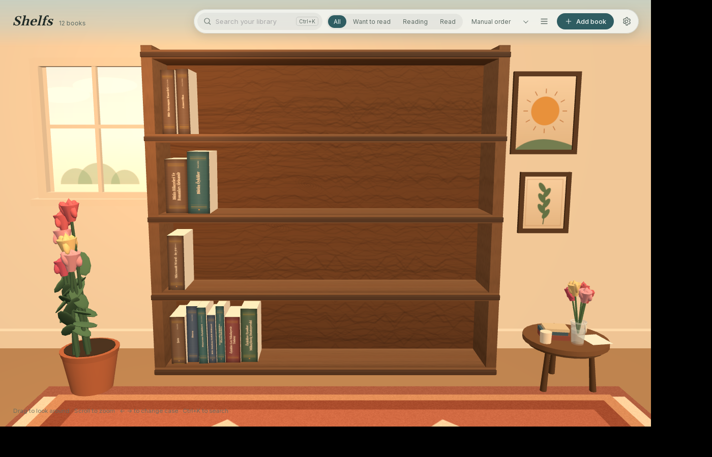
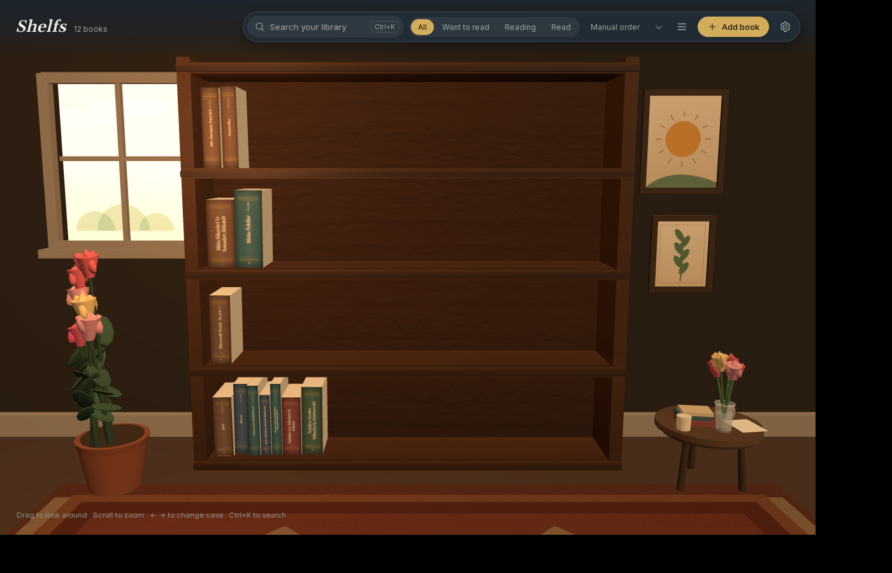
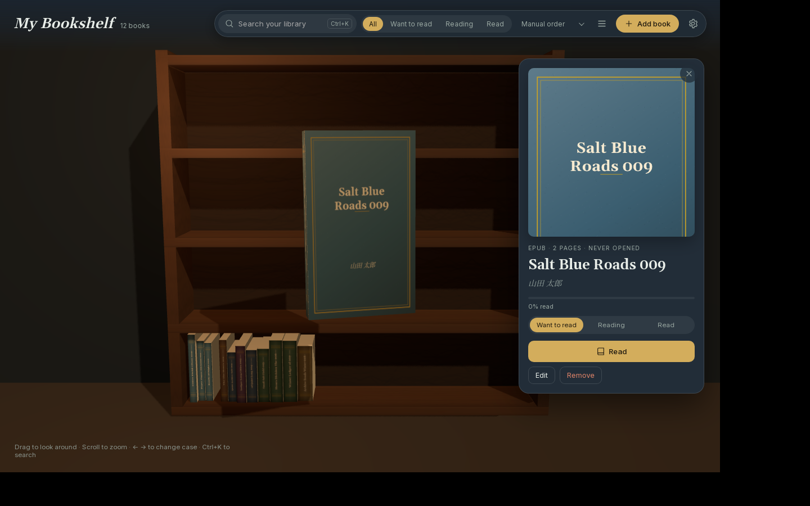
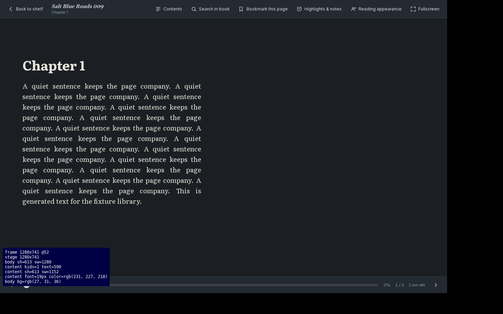
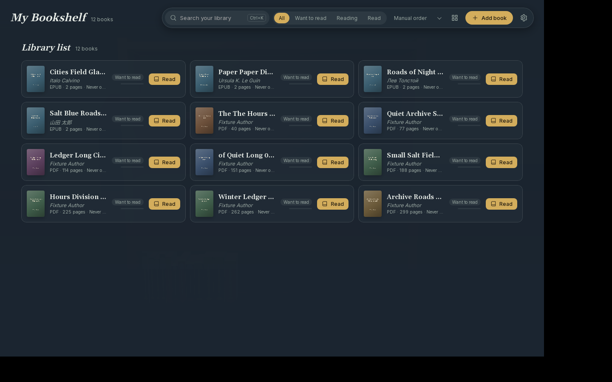

# Shelfs

[](https://github.com/ell-shad/shelfs/actions/workflows/ci.yml)
[](https://github.com/ell-shad/shelfs/releases/latest)
[](LICENSE)
[](https://tauri.app)

Download the `.deb` or the AppImage from the
[latest release](https://github.com/ell-shad/shelfs/releases/latest).

A local-first PDF and EPUB library for Ubuntu, drawn as a wooden bookcase you can
turn, zoom and take books from. Everything stays on your disk: no account, no
network access, no telemetry. Book files are opened read-only and never modified.

| Light | Dark |
|---|---|
|  |  |

| Book card | EPUB reader | Accessible list view |
|---|---|---|
|  |  |  |

Both shelf shots are real captures of the release build, taken headless with software GL
(the screenshots and how to reproduce them are described in [docs/PERF.md](docs/PERF.md)).
How each number in the prototype spec maps onto the code is in
[docs/PARITY.md](docs/PARITY.md).

## What it does

- **Shelf.** Every book is a 3D book with a generated spine (title, author, status
  dot) or its real cover. Books drop in when imported, slide when removed, and
  the shelf wraps into as many cases as the library needs (arrow keys, on-screen
  arrows, shift-drag or horizontal scroll move between cases). The case stands in
  a room — rug, window, framed prints, a potted plant and a side table with
  flowers — all drawn procedurally, so there are no image assets to ship. Books
  can be dragged onto any shelf and stay there.
- **Library.** Import by file picker, drag and drop, "Open with", or the command
  line. Duplicate detection by content hash, background import with a per-file
  error summary, metadata and cover extraction, spine colour from the cover,
  manual reordering, sorting, search and status filters, missing-file detection
  with hash-checked relinking, and an edit dialog. Removing a book never deletes
  the file.
- **Reader.** PDF through pdf.js (virtualised pages, text layer, thumbnails,
  outline, zoom/rotate/fit, single/continuous/spread, night mode, password
  prompt) and EPUB through a Rust parser plus a sandboxed webview renderer
  (paginated or scroll, spread on wide windows, appearance controls, bundled
  fonts, images, footnotes, RTL best effort). Both resume where you stopped, and
  both share bookmarks, highlights with notes, in-book search, themes and
  annotation export.
- **Accessible view.** A list/grid mode that needs no GPU, with full keyboard
  operation, ARIA labels, visible focus and reduced-motion support.

## Installing on Ubuntu 24.04

```bash
sudo apt install build-essential curl pkg-config libssl-dev \
  libwebkit2gtk-4.1-dev libgtk-3-dev librsvg2-dev patchelf
# Rust, if you do not have it
curl --proto '=https' --tlsv1.2 -sSf https://sh.rustup.rs | sh
# Node 20+ for the frontend build
```

## Build, run, test

```bash
npm install                 # frontend dependencies (also copies pdf.js assets)
npm run app:dev             # Tauri dev window (starts Vite for you)
npm run dev:web             # Vite alone, http://127.0.0.1:1420, for frontend work
npm run build:web           # typecheck + production frontend bundle
npm run app:build           # release binary, no installer
npm run bundle:deb          # .deb in src-tauri/target/release/bundle/deb
npm run bundle:appimage     # .AppImage in .../bundle/appimage
```

Checks, the same set CI runs:

```bash
npm run typecheck           # tsc --noEmit
npm run lint                # eslint
npm run test                # vitest (frontend units)
cd src-tauri
cargo fmt --check
cargo clippy --all-targets --features dev-tools -- -D warnings
cargo test --features dev-tools   # 61 tests: layout, db, import, formats, locators
```

Headless visual check (no display needed — starts Xvfb, software GL, screenshots):

```bash
scripts/gui-smoke.sh screenshots/smoke.png /path/to/books      # one screenshot
scripts/gui-drive.sh /tmp/shots /path/to/books                 # scripted steps
BS_STEPS=scripts/steps/open-reader.sh scripts/gui-drive.sh /tmp/shots /path/to/books
```

Generate test books instead of using real ones:

```bash
cd src-tauri
# dev-only helpers need the dev-tools feature; the app itself needs none
# (cargo build --release builds only the app binary).
cargo run --features dev-tools --bin make-fixtures -- /tmp/books 40 10
```

## Command line

```bash
bookshelf file.pdf other.epub     # import into the running window, or start it
bookshelf ~/Books                 # import a folder (recursive, PDF/EPUB only)
```

A second launch hands its arguments to the running instance and exits.

## Keyboard

| Where | Key | Action |
|---|---|---|
| Shelf | `Ctrl+K` / `/` | Search the library |
| Shelf | `←` `→` | Previous / next case |
| Shelf | `Shift`+drag | Pan between cases |
| Shelf | `Ctrl+O` | Add books |
| Shelf | `Esc` | Close the card / clear search |
| Reader | `←` `→` `PgUp` `PgDn` `Space` `Shift+Space` | Turn pages |
| Reader | `Home` `End` | Start / end of book |
| Reader | `Ctrl+F` | Search in book |
| Reader | `Ctrl+G` | Go to page or percent |
| Reader | `B` | Bookmark this page |
| Reader | `T` | Contents |
| Reader | `+` `-` `0` | Zoom in / out / reset |
| Reader | `F11` | Fullscreen |
| Reader | `Esc` | Close panel, then the reader |

## Where things live

| Path | Contents |
|---|---|
| `$XDG_DATA_HOME/bookshelf/library.sqlite3` | library, progress, bookmarks, annotations, settings |
| `$XDG_DATA_HOME/bookshelf/books/` | file copies, only if you choose copy mode |
| `$XDG_CACHE_HOME/bookshelf/covers/` `thumbs/` | extracted covers, PDF thumbnails |
| `$XDG_CONFIG_HOME/bookshelf/` | reserved for external config |

Back up and restore from Preferences; the backup is a ZIP with a JSON manifest and
the covers, and restores by content hash so it is safe to apply twice.

## Performance

Measured numbers (cold start, frame time, artifact sizes) and how to reproduce them
are in [docs/PERF.md](docs/PERF.md). Short version: on the development machine the
window is up in ~200 ms, and with 220 books under software rendering the shelf is
populated in ~7 s and settles at 40-53 fps. GPU-accelerated numbers were not
measured — see the caveats there.

## Packaging notes

- App id `com.ellshad.bookshelf` (it affects the .desktop name, MIME handler and
  data directory). The library itself lives in `~/.local/share/bookshelf`, which is
  independent of the id, so renaming the id never moves your books.
- `.deb` ships the `.desktop` file, hicolor icons and the AppStream metainfo in
  [packaging/com.ellshad.bookshelf.metainfo.xml](packaging/com.ellshad.bookshelf.metainfo.xml).
- On exotic GPUs or Wayland compositors where the window stays blank, run once with
  `WEBKIT_DISABLE_COMPOSITING_MODE=1` (and/or `WEBKIT_DISABLE_DMABUF_RENDERER=1`).
  The app also detects software rendering and offers performance mode.

## Licence

Shelfs is free software: you can redistribute it and/or modify it under the
terms of the GNU General Public License as published by the Free Software
Foundation, either version 3 of the License, or (at your option) any later
version. It is distributed in the hope that it will be useful, but **without any
warranty**, without even the implied warranty of merchantability or fitness for a
particular purpose. See the [GNU General Public License](LICENSE) for details.

Copyright (C) 2026 Elshad Guliyev.

Third-party components keep their own licences: Tauri and three.js are MIT,
pdf.js is Apache-2.0, and the bundled fonts are SIL OFL 1.1 (Literata, Source
Serif 4, Gelasio, Inter, OpenDyslexic); see [ui/public/fonts](ui/public/fonts/OFL.txt).
The GPL text and the third-party notices ship with the `.deb` under
`/usr/share/doc/bookshelf/`.
